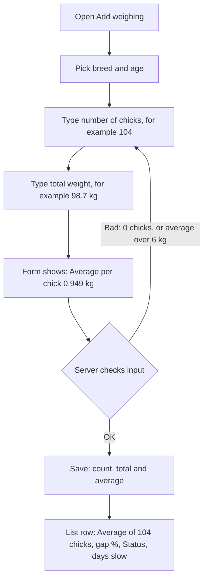
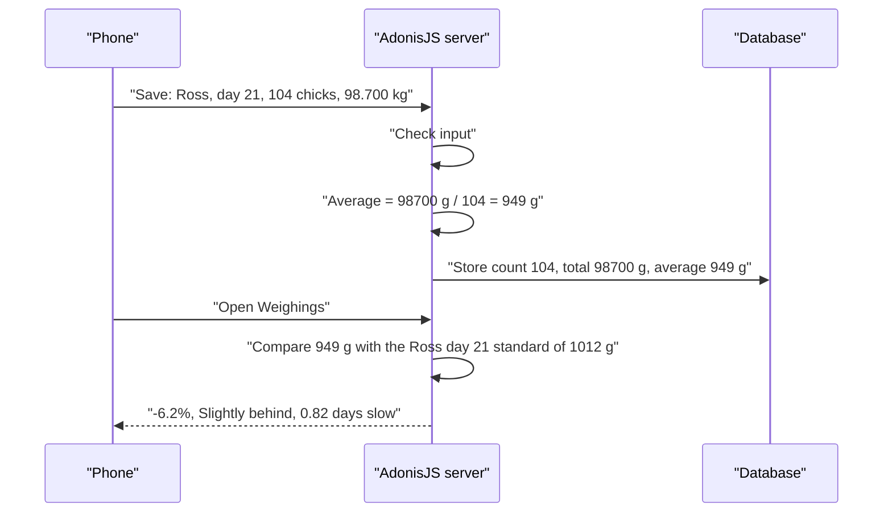
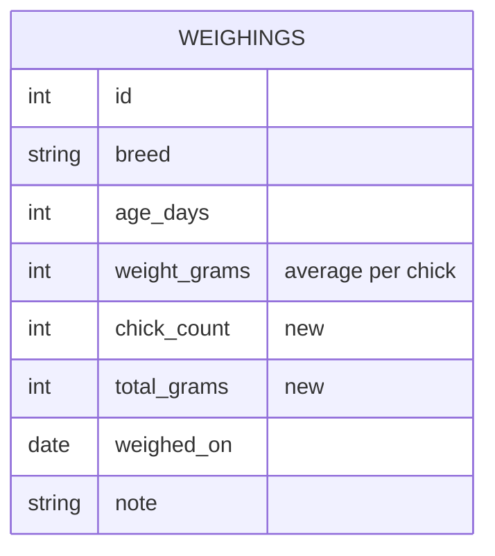

# Plan: Weigh a batch of chicks and compare the average

**Status:** Confirmed on 2026-10-31
**Type:** feature
**Branch:** feature/chicken-weight-tracker (current branch; you can make a new `feature/chick-batches` branch in Sourcetree first if you want a separate pull request)

## In plain words
Your sister often weighs many chicks together, for example 10 chicks or 104 chicks. Today the form only takes one weight. We add a field called **number of chicks**. She types how many chicks and the **total weight** of all of them. The app divides to get the **Average Weight** per chick, and only that average is compared with the Standard Weight. The gap in %, the Status and the "days slow or fast" line all use the average. A single chick is just a Batch of 1, so how she uses the app today does not change.

## What will be different after this
| Who | Before | After |
| :--- | :--- | :--- |
| Your sister | Types one chick's weight only | Types "104 chicks, 98.7 kg" and sees the average (0.949 kg) compared with the standard. One chick still works as before. |
| Old weighings | One chick each | Unchanged. They become a Batch of 1. |
| You (admin) | n/a | One database change, applied automatically on the next deploy |

## The big picture
What this shows: what she does on the form, and what she sees.



What this shows: what happens behind the scenes. The average is saved with the weighing, so everything that already works with one weight keeps working.



## Data changes
What this shows: two new columns on the existing weighings table.



| Column | What it stores | Example |
| :--- | :--- | :--- |
| `chick_count` (new) | How many chicks were weighed, 1 to 1000. Old rows get 1. | `104` |
| `total_grams` (new) | The total weight she typed, in whole grams. Old rows get their own weight. | `98700` |
| `weight_grams` (same as before) | Now the **Average Weight** per chick, rounded to a whole gram. This is what is compared with the standard. | `949` |

- We keep the exact total so that when she edits a batch the form shows what she typed (98.700 kg), not a number worked backwards from the rounded average (98.696 kg).
- `weight_grams` keeps its name and meaning "the weight to compare", so the status, days and tests already written keep working.
- The migration (a script that changes the database tables) adds the two columns, fills in the old rows, and can be undone.

## Patterns we'll follow
| Kind of code | Existing example | The pattern |
| :--- | :--- | :--- |
| Maths | `app/services/weight_status_service.ts`, `growth_schedule_service.ts` | A pure function (no database), whole grams, whole-number maths |
| Migration | `database/migrations/1793420243743_create_weighings_table.ts` | One migration, with a working `down()` and check rules |
| Validation | `app/validators/weighing.ts` | One VineJS validator for add and edit, friendly messages in one place |
| Controller | `app/controllers/weighings_controller.ts` (`toColumns`) | Thin: convert the form into columns, then save |
| Sending to the page | `app/transformers/weighing_transformer.ts` | The transformer adds fields to each weighing |
| Server tests | `tests/functional/weighings.spec.ts` | Japa HTTP tests with `loginAs`, `withCsrfToken` and `withInertia` |
| Pages | `inertia/components/weighing_fields.vue`, `inertia/pages/weighings/*.vue` | Follow `docs/design-direction.md` |

## Pattern changes
None: all new code follows existing patterns.

## Phase roadmap
What this shows: the 3 phases in order. Each one leaves the app working.


## Phases

### Phase 1: Database and average maths
- **In plain words:** Add the two new columns, and a function that turns a total and a number of chicks into the average. The server also sends the count and total with every weighing.
- **What you'll see after this phase:** Nothing new on the page. Everything works as before, and every old weighing counts as a Batch of 1.
- **How to try it yourself:** `node ace test` passes. `node ace migration:run` adds the columns. `node ace migration:rollback` removes them.
- **Files:** `database/migrations/<new>_add_batch_to_weighings_table.ts` (new), `database/schema.ts` (regenerated by the migration), `app/services/batch_average_service.ts` (new), `app/transformers/weighing_transformer.ts`, `app/controllers/weighings_controller.ts` (store the count 1 and total = weight, so saving keeps working), `tests/unit/batch_average_service.spec.ts` (new), `tests/functional/weighings.spec.ts` (each place that creates a weighing directly gets the extra `totalGrams` field; their checks do not change)
- **Follows:** `weight_status_service.ts`, `growth_schedule_service.ts`, the create_weighings migration
- **Done when:** the cases below pass, the existing tests still pass, typecheck and lint pass, and the migration can be rolled back.
- **Tests** (seam: `averageWeightGrams(totalGrams, chickCount)`, and the Weighings list route):

| Test name | Example | Expected |
| :--- | :--- | :--- |
| average of 10 chicks | total 7890 g, 10 chicks | 789 g |
| average of 104 chicks rounds to the nearest gram | total 98700 g, 104 chicks | 949 g (949.04) |
| an exact half rounds up | total 9495 g, 10 chicks | 950 g |
| one chick is its own average | total 950 g, 1 chick | 950 g |
| an old weighing shows as a batch of 1 | saved Ross, day 21, 950 g | list row has chickCount 1 and totalGrams 950 |
| the migration fills in old rows | (checked by running migrate on a database with a weighing, then by hand) | total = weight, count = 1 |

### Phase 2: Save and edit batches
- **In plain words:** The form data now includes the number of chicks. The server checks it, works out the average, and saves count, total and average.
- **What you'll see after this phase:** Nothing new on the form yet (Phase 3 adds the fields), but you can try it with a test or a tool that sends the form.
- **How to try it yourself:** `node ace test --files tests/functional/weighings.spec.ts`
- **Files:** `app/validators/weighing.ts`, `app/controllers/weighings_controller.ts`, `tests/functional/weighings.spec.ts`
- **Follows:** the current validator, `toColumns` and the current Japa HTTP tests
- **Rules:** `chickCount` is a whole number from 1 to 1000. If it is left out, it is 1. `weightKg` is now the total weight of the Batch. The average must be more than 0 and 6 kg or less (this replaces the old "6 kg or less" rule for one chick; it is the same rule when there is 1 chick).
- **Messages:** "Number of chicks must be a whole number from 1 to 1000" and "Average weight must be 6 kg or less".
- **Done when:** the cases below pass and all earlier tests still pass.
- **Tests** (seam: `POST /weighings`, `PUT /weighings/:id`, and `GET /weighings/:id/edit`):

| Test name | Example | Expected |
| :--- | :--- | :--- |
| saves a batch of 10 and compares the average | 10 chicks, 7.890 kg, Ross day 20 | average 789 g, -15.6%, Behind, 2 days slow |
| saves a batch of 104 and compares the average | 104 chicks, 98.700 kg, Ross day 21 | average 949 g, -6.2%, Slightly behind, 0.82 days slow |
| an exact half rounds up when saving | 10 chicks, 9.495 kg | average 950 g |
| one chick works as before | no chick count, 0.950 kg, Ross day 21 | count 1, -6.1%, Slightly behind |
| rejects a bad number of chicks | 0, 1.5, 1001 | "Number of chicks must be a whole number from 1 to 1000" |
| rejects an average over 6 kg | 10 chicks, 61 kg | "Average weight must be 6 kg or less" |
| keeps the exact total when editing | open a saved 104-chick batch | form values show 104 and 98.700 kg |
| updating a batch changes the average and status | change that batch to 104 chicks, 105.000 kg | average 1010 g, status On track |

### Phase 3: Form and list pages [frontend]
- **In plain words:** Add the "Number of chicks" field and a live "Average per chick" line to the form, and show batches clearly in the list.
- **What you'll see after this phase:** On the Add and Edit forms, a big "Number of chicks" box (starts at 1) above the weight. The weight box is labelled "Total weight" when there is more than 1 chick. Below it, "Average per chick: 0.949 kg" and the standard weight for that breed and day. In the list, a row for a batch says "Average of 104 chicks" and shows the total.
- **How to try it yourself:** `npm run dev`, log in, add Ross / day 21 / 104 chicks / 98.7 kg. Check the live average while typing, then the row in the list. Then edit it.
- **Files:** `inertia/components/weighing_fields.vue`, `inertia/pages/weighings/{create,edit,index}.vue`, `inertia/utils/format.ts`, `inertia/css/app.css`, `docs/design-direction.md`
- **Follows:** `docs/design-direction.md` and the existing form and row styles. `frontend-design` is loaded first, as the rules ask.
- **Done when:** it reads well at 360 px width, the live average matches what the server saves, and all earlier checks still pass.
- **Tests:** styling and display only, so no new automated tests. The numbers are proved in Phases 1 and 2. You check the page by hand.
- **Page sketch:**
```
┌──────────────────────────┐   ┌──────────────────────────┐
│ Day 21  Ross      31 Oct │   │ ← Add weighing           │
│ 0.949 kg   standard 1.012│   │ Breed (Ross)(Cobb)(AA+)  │
│ Average of 104 chicks    │   │ Age in days       [ 21 ] │
│ Total 98.700 kg          │   │ Number of chicks  [ 104 ]│
│ [====gauge======|====]   │   │ Total weight  [98.700 kg]│
│ −6.2%  ⚠ Slightly behind │   │ Average per chick: 0.949 │
│ ⏱ 0.82 days slow   Edit  │   │ Standard, day 21: 1.012  │
└──────────────────────────┘   │ Date, Note               │
                               └──────────────────────────┘
```

## Decisions we made
| Question | We chose | Why |
| :--- | :--- | :--- |
| How does she enter a batch? | Number of chicks + total weight | Fast on a phone, even for 104 chicks |
| Where does a batch live? | Inside the normal Weighing | Smallest change, and old records keep working |
| Anything besides the average? | No | You said "only compare" the average. We can add more later. |
| Batch size | 1 to 1000 | Covers 10 and 104 with room to spare |
| Rounding | Average to a whole gram, an exact half rounds up | Matches how weights are stored and compared today |
| The 6 kg limit | Applies to the average per chick | A 104-chick total is far over 6 kg and must be allowed |
| What is saved | Count, exact total and the rounded average | Editing shows exactly what she typed |
| Field name `weightKg` | Keep the name, it now means the total weight | Avoids renaming it everywhere, the label on the page says "Total weight" |

## Words used in this plan
| Word | What it means here |
| :--- | :--- |
| Batch | The chicks weighed together in one Weighing (see `GLOSSARY.md`) |
| Average Weight | Total weight ÷ number of chicks, to the nearest gram |
| Migration | A script that changes the database tables, so your PC and the live server get the same tables |
| Pure function | Code that only turns inputs into an answer and touches no database, so it is easy to test |
| Seam | The public entry point a test goes through (a function or a URL) |
| Red → green | Write a test, watch it fail (red), then write code until it passes (green) |
| Backfill | Filling in a new column for rows that already exist |

## Risks and assumptions
- **Assumption:** she weighs the whole group together and types the total. If she actually weighs chick by chick, we would need a different form (you chose the total method).
- **Risk: typing the average in the total box.** If she types 0.949 as the total for 104 chicks, the average is only 9 g. The live "Average per chick" line and the standard hint on the form make this easy to spot, and the 6 kg rule catches the opposite mistake.
- **Risk: rounding.** The average is rounded to a whole gram. That is at most 0.5 g, about 1% for a day-0 chick and under 0.1% from day 21 on.
- **Risk: old rows.** The migration gives every old weighing a count of 1 and a total equal to its weight. If it fails halfway, `migration:rollback` undoes it. It runs automatically on the next Render deploy (the start command runs migrations).
- **Risk: duplicate numbers.** The average is saved as well as the total. Only one place in the code writes them, and tests check they agree.
- **Out of scope:** each chick's own weight, lightest and heaviest, how even the batch is, and flocks.

## Acceptance criteria (whole change)
- [ ] She can enter a number of chicks and a total weight, and the app saves the average
- [ ] 10 chicks / 7.890 kg on Ross day 20 gives average 789 g, -15.6%, Behind
- [ ] 104 chicks / 98.700 kg on Ross day 21 gives average 949 g, -6.2%, Slightly behind
- [ ] Status and days slow/fast use the average
- [ ] One chick works exactly as before, and old weighings still show correctly
- [ ] 0, 1.5 or more than 1000 chicks, and an average over 6 kg, are rejected with a clear message
- [ ] Editing a batch shows the count and total she typed
- [ ] The form shows the live average while she types
- [ ] The list shows "Average of N chicks" and is readable at 360 px phone width

## Check your understanding
1. She weighs 104 chicks and the scale says 98.7 kg. What does she type, and what is compared with the standard?
   <details><summary>Answer</summary>She types 104 chicks and 98.7 kg. The app compares the average, 949 g, with the Standard Weight for that breed and age.</details>
2. Why is the "6 kg or less" rule applied to the average and not the total?
   <details><summary>Answer</summary>Because a batch of 104 chicks easily weighs over 98 kg in total. The rule is there to catch a typo in one chick's weight, so it must look at the average.</details>
3. Why do we save the total as well as the average?
   <details><summary>Answer</summary>The average is rounded to a whole gram. If we only saved the average, editing would show a total worked backwards (949 g × 104 = 98.696 kg) instead of the 98.700 kg she typed.</details>

## Progress
- [x] Phase 1: Database and average maths
- [x] Phase 2: Save and edit batches
- [ ] Phase 3: Form and list pages

## Docs updated during grilling
- `GLOSSARY.md`: added **Batch** and **Average Weight**; changed **Actual Weight** and **Weighing**
- ADRs: none (easy to change later)
