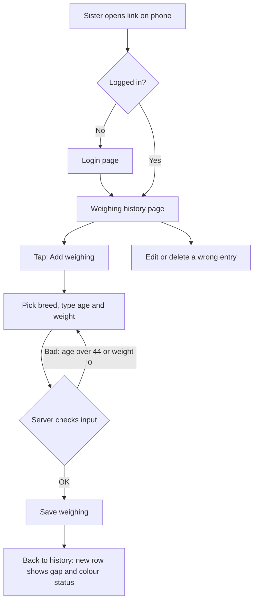
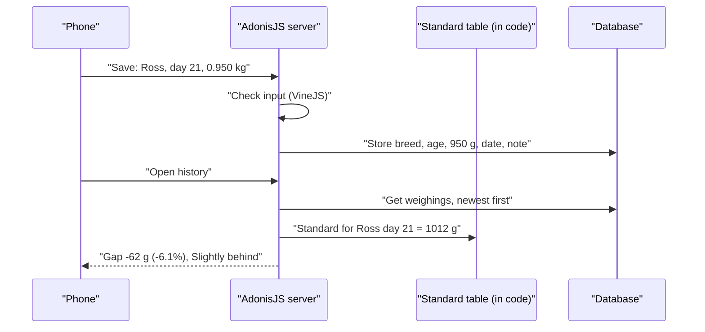
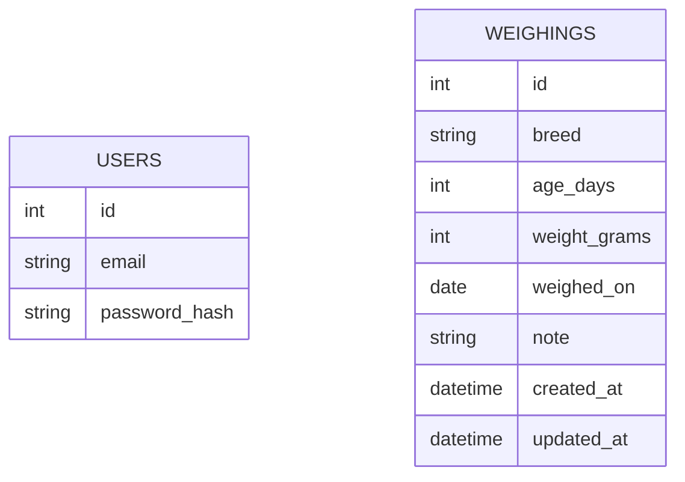
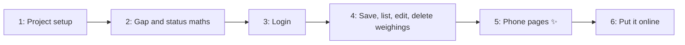

# Plan: Chicken Weight Tracker

**Status:** Confirmed on 2026-10-31
**Type:** feature (new project)
**Branch:** feature/chicken-weight-tracker

## Context
`D:\jy-chick` is empty: no code, no git yet. Your sister raises broilers (Ross, Cobb, AA Plus). She needs to enter a Breed, an Age in days and an Actual Weight, then see how far that is from the breed's Standard Weight. She uses it from her own place, so it must be online, need a login, and work well on a phone. She also wants every weighing saved, so she can look back at past weeks.

## In plain words
We'll build a small website with **AdonisJS** (a TypeScript web server framework) and **Vue** pages. It saves data in a **PostgreSQL** database (a place on a server that stores records). Your sister logs in on her phone and types the breed, age and weight. She instantly sees the Weight Gap and a coloured Status. Every weighing is saved, so she can scroll back through her history and fix typos. It runs on free hosting (Render + Neon).

## What will be different after this
| Who | Before | After |
| :--- | :--- | :--- |
| Your sister | Looks up the paper/Excel table and works out the gap by hand | Opens a link on her phone, types 3 things, sees gap + colour label, history is kept |
| You (admin) | Nothing to maintain | One small app on free hosting. You create her login with one command. |
| Strangers on the internet | n/a | See only the login page |

## Tech stack (decided)
| Part | Choice | Why, in plain words |
| :--- | :--- | :--- |
| Server | AdonisJS (latest, TypeScript) | All-in-one: routes, login, form checks, database, tests. You said Adonis works for you. |
| Pages | Vue 3 + Inertia | Inertia passes data from the server straight to Vue pages, so we don't need a separate API. |
| Database | PostgreSQL: on your PC for coding, Neon free tier when it's live | Reliable, free, and Render's free plan can't keep files on its own disk |
| Form checks | VineJS | Comes with AdonisJS. Checks input on the server, so bad data can't get in. |
| Tests | Japa | Comes with AdonisJS. Unit tests plus HTTP tests (tests that call a page like a browser would). |
| Hosting | Render free web service | RM0. Sleeps when idle, so the first visit of the day takes about 30–60 s. You can upgrade later with no code change. |

## The big picture
What this shows: what your sister does from opening the link to seeing her result.



What this shows: how one weighing is turned into a status. Only the inputs are saved. The gap and status are worked out each time the page loads, so if you change the thresholds later, old entries update too.



## Data changes
What this shows: one new table for weighings, plus the users table that comes with the starter kit (for the login).



| Column | What it stores | Example |
| :--- | :--- | :--- |
| `breed` | `ross`, `cobb` or `aa_plus` | `ross` |
| `age_days` | Whole days since hatch, 0–44 | `21` |
| `weight_grams` | Actual Weight in **grams**, a whole number. The form takes kg and we convert. | `950` |
| `weighed_on` | Date of weighing. Defaults to today in her timezone. | `2026-10-31` |
| `note` | Optional, max 100 characters | `House 2` |

- Weights are kept in whole grams so the maths has no rounding errors. In code, 0.950 kg minus 1.012 kg isn't always exactly −0.062.
- The **Standard Table** is a fixed TypeScript constant (`app/constants/standard_weights.ts`), not a database table. It only changes when the breed company publishes new numbers, and then you edit one file.
- Weighings aren't linked to a user. There's one farm with one shared login.

## Patterns we'll follow
No existing code. We follow the AdonisJS Inertia + Vue starter kit and the official docs.

| Kind of code | Where | The pattern |
| :--- | :--- | :--- |
| Calculation logic | `app/services/weight_status_service.ts` | Pure functions, no database. Easy to unit test. |
| Standard Table | `app/constants/standard_weights.ts` | Breed → array of 45 gram values, index = Age |
| Validation | `app/validators/weighing.ts` | One VineJS validator, shared by create and update |
| Controllers | `app/controllers/weighings_controller.ts`, `session_controller.ts` | Thin: check input → call model/service → redirect with a flash message |
| Routes | `start/routes.ts` | Every weighing route in a group behind `middleware.auth()` |
| Pages | `inertia/pages/weighings/*.vue`, `inertia/pages/auth/login.vue` | `<script setup lang="ts">`, Inertia `useForm` |
| Tests | `tests/unit/*.spec.ts`, `tests/functional/*.spec.ts` | Japa. Database wrapped in a transaction per test (all changes undone after). |
| Create login | `commands/create_user.ts` | Ace command. There is no public sign-up page. |

## Pattern changes
None: this is a new project, so every pattern comes from the starter kit.

## Phase roadmap
What this shows: the 6 phases in order. Each one leaves the app working.



## Phases

### Phase 1: Project setup
- **In plain words:** Create the AdonisJS project (Inertia + Vue, PostgreSQL, session login) and get its own tests passing on your PC.
- **Before this phase (you):** In Sourcetree, create a git repo in `D:\jy-chick`, commit `GLOSSARY.md` and `docs/`, then create branch `feature/chicken-weight-tracker`. Install the current Node LTS and PostgreSQL (Windows installer or Docker). Create databases `jy_chick` and `jy_chick_test`.
- **What you'll see:** The starter kit's welcome page at `http://localhost:3333`.
- **How to try it:** `npm run dev`, then open the URL. `node ace test` passes.
- **Files:** Starter kit files, `.env` / `.env.example` (DB settings, `TZ`).
- **Done when:** The app starts, `npm run typecheck` passes, `node ace test` passes.
- **Tests:** Setup only. We keep the starter kit's own tests and add no new ones.

### Phase 2: Gap and status maths
- **In plain words:** Put the Standard Table into code and write the function that turns breed + age + weight into a gap and a Status.
- **What you'll see:** Nothing on the page yet. This phase is proved by tests.
- **How to try it:** `node ace test --files tests/unit/weight_status_service.spec.ts`
- **Files:** `app/constants/standard_weights.ts`, `app/services/weight_status_service.ts`, `tests/unit/weight_status_service.spec.ts`
- **Done when:** All the cases below pass.
- **Tests** (seam: `evaluateWeighing(breed, ageDays, weightGrams)`):
  - "on track when weight equals standard": Ross 21, 1012 g → gap 0 g, 0.0%, On track
  - "slightly behind at -6.1%": Ross 21, 950 g → −62 g, −6.1%, Slightly behind
  - "behind below -10%": Cobb 35, 2100 g → −421 g, −16.7%, Behind
  - "ahead at +6.3%": AA Plus 14, 560 g → +33 g, +6.3%, Ahead
  - "exactly -10.0% is slightly behind, not behind": Cobb 10, 297 g → −33 g, −10.0%, Slightly behind
  - "has no standard for age 45": Ross 45 → error "no standard weight for this age"

### Phase 3: Login
- **In plain words:** Add a login page, a logout button and a command to create your sister's account. Nothing else is reachable without logging in.
- **What you'll see:** A plain (not yet styled) login page. After logging in you land on an empty "Weighings" page.
- **How to try it:** `node ace create:user sister@example.com`, enter a password, log in, log out.
- **Files:** `commands/create_user.ts`, remove the starter kit's public sign-up (`app/controllers/new_account_controller.ts`, `inertia/pages/auth/signup.vue`, the `signup` routes), `app/controllers/session_controller.ts`, `app/validators/user.ts`, `start/routes.ts`, `inertia/pages/auth/login.vue` (bare), `inertia/pages/weighings/index.vue` (bare), `tests/functional/auth.spec.ts`
- **Done when:** The tests below pass.
- **Tests** (seam: HTTP routes):
  - "redirects to login when not logged in and opening history"
  - "logs in with correct email and password and lands on history"
  - "shows an error with a wrong password"
  - "logs out and can no longer open history"

### Phase 4: Save, list, edit, delete weighings
- **In plain words:** The weighings table plus the server side for adding, listing (newest first, filter by breed), editing and deleting.
- **What you'll see:** The bare pages work end to end. They're ugly until Phase 5.
- **How to try it:** Log in, add Ross / 21 / 0.950, and see −6.1% Slightly behind in the list. Edit it, then delete it.
- **Files:** `database/migrations/xxxx_create_weighings_table.ts`, `app/models/weighing.ts`, `app/validators/weighing.ts`, `app/controllers/weighings_controller.ts`, `start/routes.ts`, bare `inertia/pages/weighings/{index,create,edit}.vue`, `tests/functional/weighings.spec.ts`
- **Done when:** The tests below pass and the migration can be rolled back.
- **Tests** (seam: HTTP routes):
  - "saves a weighing and shows it with gap -6.1% Slightly behind" (Ross 21, 0.950 kg)
  - "converts 0.950 kg to 950 grams when saving"
  - "rejects age 45 with 'no standard weight for this age'"
  - "rejects weight 0 with 'weight must be more than 0'"
  - "rejects a breed that isn't Ross, Cobb or AA Plus"
  - "lists newest weighing first"
  - "filters history by breed"
  - "updates a weighing and the status changes"
  - "deletes a weighing"
  - "cannot add, edit or delete when not logged in"

### Phase 5: Phone pages ✨ [frontend]
- **In plain words:** Make the login, history, add and edit pages look good and easy to use on a phone. First we agree a design direction (colours, fonts) and save it to `docs/design-direction.md`.
- **What you'll see:** The finished app on your phone's browser.
- **How to try it:** `npm run dev` with `--host`, then open `http://<your-PC-IP>:3333` on a phone on the same Wi-Fi. Test add, edit, delete, filter, and the empty history state.
- **Files:** `inertia/pages/**`, `inertia/layouts/app.vue`, `inertia/components/status_badge.vue`, `inertia/components/weighing_form.vue`, `inertia/css/app.css`, `docs/design-direction.md`
- **Done when:** It works at 360 px phone width, the colour labels are readable, and every form error shows next to its field.
- **Tests:** Styling only, so no new automated tests. The Phase 4 tests must still pass.
- **Page sketch:**
```
┌──────────────────────────┐   ┌──────────────────────────┐
│ JY Chick        [Logout] │   │ ← Add weighing           │
│ [All][Ross][Cobb][AA+]   │   │ Breed  (Ross)(Cobb)(AA+) │
│ ┌──────────────────────┐ │   │ Age (days)   [ 21 ]      │
│ │ 31 Oct · Ross · D21  │ │   │ Weight (kg)  [ 0.950 ]   │
│ │ 0.950 / 1.012 kg     │ │   │ Date         [31/10/26]  │
│ │ -6.1% 🟠 Slightly beh│ │   │ Note         [House 2 ]  │
│ │ House 2        [✎]  │ │   │                          │
│ └──────────────────────┘ │   │ Standard today: 1.012 kg │
│ ┌──────────────────────┐ │   │                          │
│ │ 24 Oct · Cobb · D35  │ │   │ [      Save       ]      │
│ │ -16.7% 🔴 Behind      │ │   └──────────────────────────┘
│ └──────────────────────┘ │
│          [ + Add ]       │
└──────────────────────────┘
```

### Phase 6: Put it online
- **In plain words:** Create a free Neon database and a free Render web service, set the secrets, run migrations, create your sister's login, and send her the link.
- **What you'll see:** The app at `https://<name>.onrender.com` on her phone.
- **How to try it:** Open the link in mobile data (not your Wi-Fi), log in, and add one weighing.
- **Files:** `render.yaml` (build/start commands, runs migrations on deploy), `docs/deploy.md` (step-by-step for you), `.env.example`
- **Done when:** She can log in from her own phone, and you've checked `engineering:deploy-checklist`.
- **Tests:** Deploy config only. The full test suite passes before deploying.

## Notes found during Phase 1
- The starter kit is AdonisJS 7 (the generator's kit name is `vue`). Controllers are wired through `#generated/controllers`, models extend a generated schema class from `#database/schema`, and Vue files are named in `snake_case` (e.g. `nav_link.vue`). New code follows these.
- The kit shipped with SQLite and a **public `/signup` page**. We switched to PostgreSQL. The sign-up page is removed in Phase 3, because the plan says there is no public sign-up.
- The kit has no `#constants/*` import alias. In Phase 2 we either add one in `package.json` or put the Standard Table in `app/services/`.
- `npm audit` reports 21 low/moderate issues inside the framework's own dependencies (no high or critical). Re-check at Phase 6.
- Baseline: typecheck pass, lint pass, `node ace test` = no tests executed (the kit has none).

## Decisions we made
| Question | We chose | Why |
| :--- | :--- | :--- |
| Save history or calculator only? | Save history | She can follow growth over weeks |
| How entries are grouped | Loose entries (breed + age + weight each time) | Matches how she works. A note field can label the house. |
| Status labels | ≥ +5% Ahead, −5% to +5% On track, −10% to −5% Slightly behind, < −10% Behind | Quick to read. % is rounded to 1 decimal before picking the label. |
| Tech stack | AdonisJS + Inertia/Vue + PostgreSQL | One language (TypeScript), built-in login and tests, you know it |
| Hosting | Render free + Neon free | RM0, and you can upgrade later without changing code |
| Extra fields | Date (default today) + optional note, edit and delete | She can fix typos and label houses |
| Gap and Status saved or computed? | Computed when the page loads | Changing the thresholds later updates old rows too |
| Standard Table location | Code constant | It's fixed numbers. A database table would add work with no benefit. |
| Accounts | One shared login, created by a command | There's only one farm. Public sign-up would let strangers in. |

## Words used in this plan
| Word | What it means here |
| :--- | :--- |
| Framework (AdonisJS) | A ready-made skeleton for a web server, so we don't write login, routing etc. from scratch |
| Inertia | A bridge that hands data from the server directly to a Vue page |
| Database / PostgreSQL | Where saved weighings live. It's like a spreadsheet the server reads and writes. |
| Migration | A script that creates or changes database tables, so your PC and the live server have the same tables |
| Validator (VineJS) | Code on the server that checks form input, e.g. "age must be 0–44" |
| Middleware (auth) | Code that runs before a page loads, like a guard at the door: "are you logged in?" |
| Seam | The public entry point a test goes through (a function or a URL) |
| Red → green | Write a test, watch it fail (red), then write code until it passes (green) |
| Cold start | Free hosting sleeps when unused, and the first visit wakes it up (slow) |
| Environment variable | A setting such as the database password, kept outside the code |

## Risks and assumptions
- **Assumption:** She uses a phone browser, in English, typing weights in kg with up to 3 decimals.
- **Decided:** Her timezone is `Asia/Kuala_Lumpur`, set with the `TZ` setting.
- **Assumption:** The maximum sensible weight is 6 kg. Anything above is rejected as a typo.
- **Risk: free hosting sleeps.** The first load each day takes 30–60 s. Fix: Render Starter (~US$7/month), a settings change only.
- **Risk: Neon's free plan limits.** These are far more than one farm will ever use. Neon also keeps short-term backups.
- **Risk: Standard Table typo.** I copied it from your image (below). Please double-check a few rows.
- **Risk: forgotten password.** There's no "forgot password" email. You reset it with `node ace create:user` (it updates an existing user).
- **Out of scope for now:** charts, flocks/batches, multiple users, other languages, export to Excel.

## Standard Table (copied from your image, kg)
| Day | Ross | Cobb | AA Plus | | Day | Ross | Cobb | AA Plus |
|---|---|---|---|---|---|---|---|---|
| 0 | 0.044 | 0.042 | 0.044 | | 23 | 1.174 | 1.296 | 1.168 |
| 1 | 0.062 | 0.055 | 0.061 | | 24 | 1.258 | 1.390 | 1.252 |
| 2 | 0.081 | 0.071 | 0.079 | | 25 | 1.345 | 1.486 | 1.339 |
| 3 | 0.102 | 0.090 | 0.100 | | 26 | 1.434 | 1.583 | 1.428 |
| 4 | 0.125 | 0.112 | 0.123 | | 27 | 1.524 | 1.682 | 1.518 |
| 5 | 0.151 | 0.138 | 0.148 | | 28 | 1.616 | 1.783 | 1.611 |
| 6 | 0.181 | 0.168 | 0.177 | | 29 | 1.710 | 1.886 | 1.704 |
| 7 | 0.213 | 0.202 | 0.209 | | 30 | 1.805 | 1.989 | 1.799 |
| 8 | 0.249 | 0.240 | 0.244 | | 31 | 1.901 | 2.094 | 1.895 |
| 9 | 0.288 | 0.283 | 0.283 | | 32 | 1.999 | 2.200 | 1.992 |
| 10 | 0.330 | 0.330 | 0.325 | | 33 | 2.097 | 2.306 | 2.090 |
| 11 | 0.376 | 0.382 | 0.370 | | 34 | 2.196 | 2.413 | 2.188 |
| 12 | 0.425 | 0.440 | 0.419 | | 35 | 2.296 | 2.521 | 2.287 |
| 13 | 0.477 | 0.503 | 0.471 | | 36 | 2.396 | 2.629 | 2.386 |
| 14 | 0.533 | 0.570 | 0.527 | | 37 | 2.496 | 2.738 | 2.486 |
| 15 | 0.592 | 0.639 | 0.586 | | 38 | 2.597 | 2.846 | 2.585 |
| 16 | 0.655 | 0.711 | 0.648 | | 39 | 2.697 | 2.954 | 2.684 |
| 17 | 0.720 | 0.786 | 0.714 | | 40 | 2.798 | 3.062 | 2.784 |
| 18 | 0.789 | 0.864 | 0.782 | | 41 | 2.898 | 3.170 | 2.882 |
| 19 | 0.860 | 0.945 | 0.854 | | 42 | 2.998 | 3.278 | 2.981 |
| 20 | 0.935 | 1.029 | 0.928 | | 43 | 3.097 | 3.384 | 3.079 |
| 21 | 1.012 | 1.116 | 1.006 | | 44 | 3.197 | 3.490 | 3.176 |
| 22 | 1.092 | 1.205 | 1.085 | | | | | |

## Acceptance criteria (whole change)
- [ ] Sister can log in from her own phone over the internet
- [ ] Strangers without the password see only the login page
- [ ] She can add a weighing (breed, age, kg, date, note) and immediately see gap kg, gap % and a coloured Status
- [ ] All 6 maths example cases give exactly the expected results
- [ ] Age outside 0–44, weight ≤ 0 or > 6 kg, and an unknown breed are rejected with a clear message
- [ ] History lists newest first and can be filtered by breed
- [ ] She can edit and delete a weighing
- [ ] Pages are comfortable to use at 360 px phone width

## Verification
- Every phase: `npm run typecheck`, `npm run lint`, `node ace test` (compared against the Phase 1 baseline), then `engineering:code-review` on that phase's files.
- By hand after Phase 5: run on your PC and open it on a phone over Wi-Fi.
- By hand after Phase 6: open the live link on mobile data and do the full add → edit → delete flow.

## Check your understanding
1. If you later decide "On track" should be ±3% instead of ±5%, do old saved weighings need to be changed in the database?
   <details><summary>Answer</summary>No. Only breed, age and weight are saved. The gap and status are worked out each time the page loads, so old rows show the new label straight away.</details>
2. Why do we store 950 instead of 0.950?
   <details><summary>Answer</summary>Whole grams avoid computer rounding errors with decimals, so −10.0% isn't accidentally treated as −10.0000001% (Behind).</details>
3. Your sister says the app took a whole minute to open this morning. Is it broken?
   <details><summary>Answer</summary>Probably not. Free Render hosting sleeps when idle and needs about 30–60 s to wake. Upgrading to a paid plan removes this.</details>

## Progress
- [x] Phase 1: Project setup (database connection still to be checked once `DB_PASSWORD` is in `.env`)
- [ ] Phase 2: Gap and status maths
- [ ] Phase 3: Login
- [ ] Phase 4: Save, list, edit, delete weighings
- [ ] Phase 5: Phone pages
- [ ] Phase 6: Put it online

## Docs to write right after you approve (before any code)
- `docs/plans/2026-10-31-chicken-weight-tracker.md`: this plan
- `GLOSSARY.md`: add **Weighing** (one saved entry), **Status** (the 4 labels and their cut-offs), **Standard Table**
- `docs/adr/0001-adonisjs-inertia-vue-postgres.md`: why this stack and free Render + Neon (hard to change later, and real alternatives existed: Laravel, Supabase)
- Then you reply **confirm** to start Phase 1 (after setting up git and the branch in Sourcetree).
