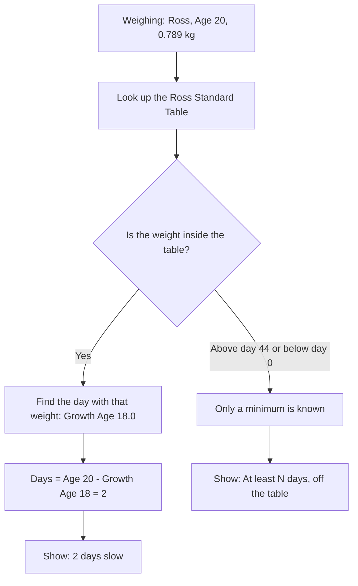
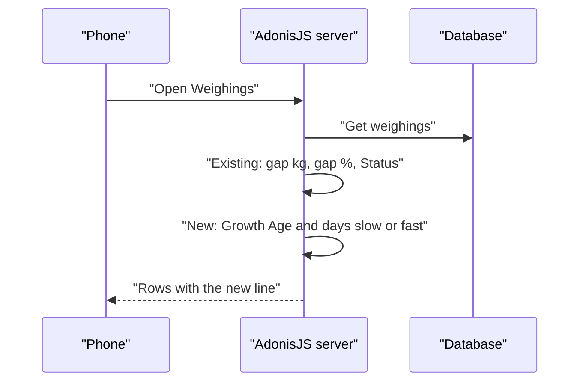
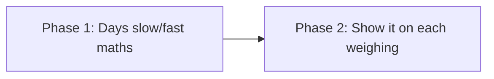

# Plan: Days slow / days fast on every weighing

**Status:** Done on 2026-10-31
**Type:** feature
**Branch:** feature/chicken-weight-tracker (current branch; you can make a new `feature/days-slow-fast` branch in Sourcetree first if you want a separate pull request)

## In plain words
Today every Weighing shows how far the weight is from the standard in **percent** (for example −15.6%, Behind). We add one more line that says it in **days**: "2 days slow". The app looks in the Standard Table for the day that has the same weight as the chicken. Your sister's chick weighs 0.789 kg. A Ross chick should weigh that on day 18, but this one is 20 days old. So it is 2 days slow. The Status colour and rules do not change.

## What will be different after this
| Who | Before | After |
| :--- | :--- | :--- |
| Your sister | Sees the gap in kg and %, and a colour label | Also sees "2 days slow", "On schedule" or "1.85 days fast" on every weighing, old ones too |
| You (admin) | n/a | Nothing new to look after. No database change. |

## The big picture
What this shows: how one weighing becomes "days slow". The Growth Age is found by walking up the Standard Table until the weight is reached, then placing the weight part-way between two days.



What this shows: how the result sits next to what the page already shows. Only the inputs are saved, so nothing is stored for days.



## Data changes
No database changes. Days are worked out each time the page loads, like Status, so old weighings get the new line straight away.

## Patterns we'll follow
| Kind of code | Existing example | The pattern |
| :--- | :--- | :--- |
| Maths | `app/services/weight_status_service.ts` | A pure function (no database) taking breed, age and grams. Whole grams, integer maths, round half away from zero, never `-0` |
| Sending to the page | `app/transformers/weighing_transformer.ts` | The transformer adds the result to each weighing |
| Unit tests | `tests/unit/weight_status_service.spec.ts` | One test per case, expected values written by hand |
| Server tests | `tests/functional/weighings.spec.ts` | Japa HTTP test with `loginAs` and `withInertia`, checks `inertiaProps` |
| Page | `inertia/pages/weighings/index.vue`, `inertia/utils/format.ts` | Wording helpers in `format.ts`, markup in the page, styles in `inertia/css/app.css` |

No existing example is wrong, so there are no pattern changes.

## Pattern changes
None: all new code follows existing patterns.

## Phase roadmap
What this shows: the 2 phases in order.



## Phases

### Phase 1: Days slow/fast maths
- **In plain words:** A new function that turns breed + age + weight into a number of days, with the "off the table" cases handled. It is sent to the page with every weighing.
- **What you'll see after this phase:** Nothing on the page yet. Proved by tests.
- **How to try it yourself:** `node ace test --files tests/unit/growth_schedule_service.spec.ts`
- **Files:** `app/services/growth_schedule_service.ts` (new), `app/transformers/weighing_transformer.ts`, `tests/unit/growth_schedule_service.spec.ts` (new), `tests/functional/weighings.spec.ts`
- **Follows:** `app/services/weight_status_service.ts`, `tests/unit/weight_status_service.spec.ts`
- **Done when:** all the cases below pass, the existing 36 tests still pass, typecheck and lint pass.
- **Result shape (so the page knows what to show):** `schedule: { direction: 'slow' | 'fast' | 'on_schedule', days, offTable }`. `days` is never negative. For `offTable` it is the least the chicken can be off by.
- **Maths in plain words:** Find the table day `d` whose weight is at or just below the Actual Weight. Growth Age = `d` + (Actual − table[d]) ÷ (table[d+1] − table[d]). Days = Age − Growth Age, rounded to **2 decimals** (an exact half rounds away from zero, so 0.875 gives 0.88). It is done with whole grams and whole numbers, so there are no decimal errors. Because the smallest step between two table days is 109 g, the smallest difference that is not zero is about 0.009 days, which still rounds up to 0.01. So a rounded answer is never 0.00, and "On schedule" appears only when the weight is exactly the table weight for that age.
- **Tests** (seam: `evaluateSchedule(breed, ageDays, weightGrams)`, and the Weighings list route):

| Test name | Example | Expected |
| :--- | :--- | :--- |
| slow by whole days (your example) | Ross, day 20, 789 g | slow, 2 days |
| on schedule at the standard weight | Ross, day 20, 935 g | on schedule, 0 |
| fast by whole days | Ross, day 20, 1092 g | fast, 2 days |
| slow with decimals | Cobb, day 35, 2100 g | slow, 3.94 days |
| fast with decimals | AA Plus, day 14, 560 g | fast, 0.56 days |
| another slow case between two days | Ross, day 20, 800 g | slow, 1.85 days |
| exact half rounds away from zero (slow) | Ross, day 7, 185 g (exactly 0.875) | slow, 0.88 days |
| exact half rounds away from zero (fast) | Ross, day 2, 185 g (exactly 4.125) | fast, 4.13 days |
| above the table gives a minimum | Ross, day 40, 3300 g | fast, at least 4 days, off the table |
| above the table at day 44 has no number to give | Ross, day 44, 3500 g | fast, 0 days, off the table |
| below the table gives a minimum | Ross, day 10, 30 g | slow, at least 10 days, off the table |
| a 1 g difference is still shown, not hidden | Ross, day 20, 936 g (1 g above standard) | fast, 0.01 days |
| the Weighings list carries it for a saved weighing | saved Ross, day 20, 0.789 kg | row has slow, 2 days |

### Phase 2: Show it on each weighing [frontend]
- **In plain words:** One new line in each row of the Weighings list, under the status, in plain words.
- **What you'll see after this phase:** "2 days slow", "On schedule" or "1.85 days slow" on every row. Off the table: "At least 4 days fast (off the table)", or "Ahead of the table" when there is no number.
- **How to try it yourself:** `npm run dev`, log in, add Ross / day 20 / 0.789 kg and look at the row. Then try Ross / day 20 / 0.935 kg and Ross / day 10 / 0.030 kg.
- **Files:** `inertia/pages/weighings/index.vue`, `inertia/utils/format.ts`, `inertia/css/app.css`, `docs/design-direction.md` (one line about the new element)
- **Follows:** the existing row layout and `docs/design-direction.md`. `frontend-design` is loaded first, as the rules ask.
- **Done when:** it reads well at 360 px width, the wording matches the table below, and the Phase 1 tests and the other checks still pass.
- **Wording:**

| Result | Text |
| :--- | :--- |
| slow, 2.35 | 2.35 days slow |
| fast, 1.6 | 1.6 days fast (no extra zeros: not 1.60) |
| exactly 1 | 1 day slow / 1 day fast |
| on schedule | On schedule |
| off the table, minimum 4 | At least 4 days fast (off the table) |
| off the table, no minimum | Ahead of the table |

- **Tests:** styling and wording only. The numbers are already proved in Phase 1, so there is no new automated test. You check the wording by hand on the page. (There are no frontend tests in this project yet.)
- **Page sketch:**
```
┌──────────────────────────┐
│ Day 20  Ross      31 Oct │
│ 0.789 kg  standard 0.935 │
│ [====gauge======|====]   │
│ −15.6%  ▼ Behind    Edit │
│ ⏱ 2 days slow          │
│ House 2                  │
└──────────────────────────┘
```

## Decisions we made
| Question | We chose | Why |
| :--- | :--- | :--- |
| Whole days or part days? | Up to 2 decimals (2.35 days), trailing zeros dropped (2, not 2.00) | You asked for it, and it shows even small differences |
| Weights outside the table? | Say "at least N days, off the table" | She most needs to notice these |
| Where does it show? | One line on every row of the list | Smallest change that covers "every record" |
| Does it change Status? | No, Status still uses percent | Keeps the colours she already knows |
| Saved or worked out? | Worked out each time | Same as Status, and old records get it too |
| New function or change `evaluateWeighing`? | New function | The existing tests compare the whole result, so adding fields there would break them for no reason |

## Words used in this plan
| Word | What it means here |
| :--- | :--- |
| Growth Age | The day in the Standard Table that has the same weight as the chicken (see `GLOSSARY.md`) |
| Days Slow / Days Fast | Age minus Growth Age, to 2 decimals |
| Off the table | The weight is above day 44's standard or below day 0's, so only a minimum can be said |
| Pure function | Code that only turns inputs into an answer and touches no database, so it is easy to test |
| Seam | The public entry point a test goes through (a function or a URL) |
| Red → green | Write a test, watch it fail (red), then write code until it passes (green) |

## Risks and assumptions
- **Assumption:** the tables rise every day, so one weight matches at most one day. I checked all three: yes.
- **Assumption:** between two table days the weight rises in a straight line. The table has no daily detail, so this is the best simple guess.
- **Risk:** "2 days slow" can look different from the Status (a small percent gap in an older chicken can be many days, because growth slows down later). The line and the Status measure different things, so I'll keep the wording plain and not link them.
- **Risk:** even 2 decimals are more exact than a scale really is. A 1 g difference on a chick is about 0.01 days, but a scale is rarely right to 1 g. The digits are real maths from the table, not a promise of that accuracy, so read the first digit as the useful part. "On schedule" only shows when the weight is exactly the table weight, and a near miss shows as a small number such as "0.01 days fast".
- **Risk:** at older ages the table rises about 100 g per day, so a scale error of 50 g moves the answer by about 0.5 day. That is normal, but good to know.

## Acceptance criteria (whole change)
- [x] Ross, day 20, 0.789 kg shows "2 days slow" (your example)
- [x] A weight equal to the standard shows "On schedule"
- [x] Faster-than-standard chickens show "N days fast", with up to two decimals
- [x] Weights outside the table show "at least N days" and "off the table"
- [x] Every row in the list, including old weighings, has the new line
- [x] Status colours and percent are unchanged
- [ ] The line is readable at 360 px phone width

## Check your understanding
1. A Cobb chicken is 35 days old and weighs 2.100 kg. Is it slow or fast, and roughly by how much?
   <details><summary>Answer</summary>Slow, by 3.94 days. 2.100 kg is what a Cobb should weigh at about day 31.06, and 35 − 31.06 = 3.94.</details>
2. Do we need to change anything in the database for old weighings?
   <details><summary>Answer</summary>No. Days are worked out each time the page loads, like Status.</details>
3. Why can the Status say "Behind" while the days say only "1.5 days slow"?
   <details><summary>Answer</summary>Status looks at the percent gap. Days look at how far along the growth line the chicken is. Young chicks grow fast, so a small delay in days can be a big percent.</details>

## Progress
- [x] Phase 1: Days slow/fast maths
- [x] Phase 2: Show it on each weighing (wording checked against the plan table with a script; not seen on a real phone)

## Docs updated during grilling
- `GLOSSARY.md`: added **Growth Age** and **Days Slow / Days Fast**
- ADRs: none (easy to change later, no real alternatives)
